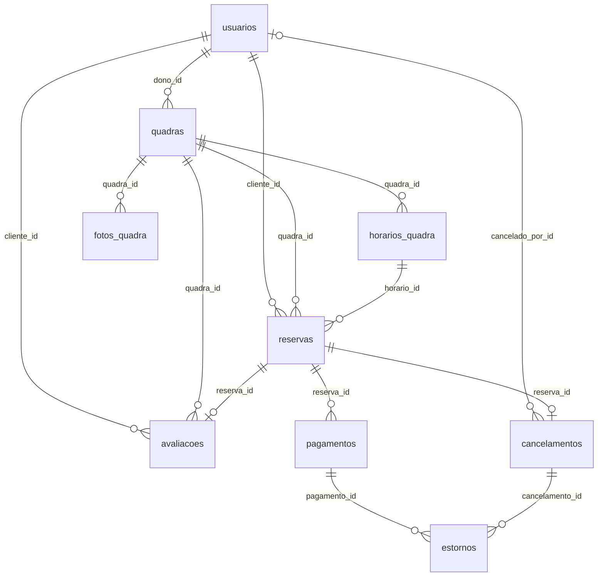

# Muzzi Tennis — Modelo de Dados

> Convertido de [`modelo_dados.pdf`](modelo_dados.pdf) (diagrama feito no dbdiagram.io). O PDF continua sendo a fonte oficial e já reflete as decisões D1, D2 e D6.
>
> Legenda: **PK** chave primária · **FK** chave estrangeira · **UQ** único · **NN** não nulo.
> A implementação está em [`backend/app/models/`](../../backend/app/models/) e as migrações em [`backend/alembic/versions/`](../../backend/alembic/versions/).

## Diagrama (relacionamentos)

## Tabelas

### usuarios

| Coluna | Tipo | Restrições |
|---|---|---|
| id | integer | PK |
| nome | varchar(150) | NN |
| email | varchar(150) | NN, UQ |
| senha_hash | varchar(255) | (nulo para clientes — decisão D1) |
| telefone | varchar(20) | |
| papel | papel_usuario | NN |
| status | boolean | NN (true = ativo — decisão D6) |
| data_desativacao | timestamp | |
| criado_em | timestamp | NN |
| atualizado_em | timestamp | NN |

### quadras

| Coluna | Tipo | Restrições |
|---|---|---|
| id | integer | PK |
| dono_id | integer | FK → usuarios.id, NN |
| nome | varchar(150) | NN |
| descricao | varchar(500) | NN |
| tipo_piso | tipo_piso | NN |
| coberta | boolean | NN |
| limite_jogadores | integer | NN |
| preco_hora | decimal(10,2) | NN |
| endereco | varchar(255) | NN |
| numero | varchar(20) | |
| bairro | varchar(100) | NN |
| cidade | varchar(100) | NN |
| estado | char(2) | NN |
| cep | varchar(9) | NN |
| ativa | boolean | NN |
| criado_em | timestamp | NN |
| atualizado_em | timestamp | NN |

### fotos_quadra

| Coluna | Tipo | Restrições |
|---|---|---|
| id | integer | PK |
| quadra_id | integer | FK → quadras.id, NN |
| url | varchar(500) | NN |
| nome_arquivo | varchar(255) | |
| tipo_arquivo | varchar(50) | |
| tamanho_bytes | integer | |
| principal | boolean | NN |
| ordem | integer | NN |
| criado_em | timestamp | NN |

### horarios_quadra

| Coluna | Tipo | Restrições |
|---|---|---|
| id | integer | PK |
| quadra_id | integer | FK → quadras.id, NN |
| data | date | NN |
| hora_inicio | time | NN |
| hora_fim | time | NN |
| preco | decimal(10,2) | (opcional; sobrepõe `quadras.preco_hora`) |
| status | status_horario | NN |
| criado_em | timestamp | NN |
| atualizado_em | timestamp | NN |

### reservas

| Coluna | Tipo | Restrições |
|---|---|---|
| id | integer | PK |
| codigo | varchar(20) | NN, UQ |
| cliente_id | integer | FK → usuarios.id, NN |
| quadra_id | integer | FK → quadras.id, NN |
| horario_id | integer | FK → horarios_quadra.id, NN |
| quantidade_jogadores | integer | NN |
| valor_total | decimal(10,2) | NN |
| status | status_reserva | NN |
| expira_em | timestamp | |
| confirmada_em | timestamp | |
| concluida_em | timestamp | |
| observacoes | varchar(300) | |
| criado_em | timestamp | NN |
| atualizado_em | timestamp | NN |

### pagamentos

| Coluna | Tipo | Restrições |
|---|---|---|
| id | integer | PK |
| reserva_id | integer | FK → reservas.id, NN |
| metodo | metodo_pagamento | NN |
| valor | decimal(10,2) | NN |
| status | status_pagamento | NN |
| codigo_transacao | varchar(100) | UQ |
| pago_em | timestamp | |
| criado_em | timestamp | NN |
| atualizado_em | timestamp | NN |

### cancelamentos

| Coluna | Tipo | Restrições |
|---|---|---|
| id | integer | PK |
| reserva_id | integer | FK → reservas.id, NN, UQ |
| cancelado_por_id | integer | FK → usuarios.id (nulo = cancelamento automático pelo sistema) |
| motivo | varchar(300) | |
| dentro_regra_24h | boolean | NN |
| percentual_estorno | decimal(5,2) | NN |
| cancelado_em | timestamp | NN |

### estornos

| Coluna | Tipo | Restrições |
|---|---|---|
| id | integer | PK |
| pagamento_id | integer | FK → pagamentos.id, NN |
| cancelamento_id | integer | FK → cancelamentos.id, NN |
| valor | decimal(10,2) | NN |
| status | status_estorno | NN |
| codigo_transacao | varchar(100) | |
| solicitado_em | timestamp | NN |
| processado_em | timestamp | |

### avaliacoes

| Coluna | Tipo | Restrições |
|---|---|---|
| id | integer | PK |
| reserva_id | integer | FK → reservas.id, NN, UQ |
| quadra_id | integer | FK → quadras.id, NN |
| cliente_id | integer | FK → usuarios.id, NN |
| nota | smallint | NN (1 a 5) |
| comentario | varchar(300) | |
| criado_em | timestamp | NN |

## Enums

| Enum | Valores |
|---|---|
| papel_usuario | `cliente`, `dono_quadra`, `administrador` |
| status_horario | `disponivel`, `reservado`, `bloqueado` |
| status_reserva | `aguardando_pagamento`, `confirmada`, `cancelada`, `expirada`, `concluida` |
| status_pagamento | `pendente`, `pago`, `falhou`, `estornado`, `estornado_parcialmente` |
| metodo_pagamento | `pix`, `cartao_credito`, `cartao_debito` |
| status_estorno | `pendente`, `processado`, `recusado` |
| tipo_piso | `saibro`, `rapida`, `grama`, `sintetico` |

## Decisões de implementação e pontos em aberto

Estes itens não estão no PDF; registram onde a implementação precisou interpretar o modelo. Itens ainda sem decisão ficam em [`docs/pendencias.md`](../pendencias.md).

- **D1 — `usuarios.senha_hash` anulável** *(confirmado pela equipe)*. Os papéis são `administrador`, `dono_quadra` e `cliente`, mas o cliente **não faz login**: ele agenda uma quadra informando apenas os dados de identificação. Como `reservas.cliente_id` é NN e aponta para `usuarios`, o cliente é gravado em `usuarios` (papel `cliente`), identificado pelo e-mail, **sem senha**. Por isso `senha_hash` é anulável no banco; donos de quadra e administradores continuam obrigados a ter senha (validação na aplicação).
- **D2 — Enum `quem_cancelou` descartado** *(confirmado pela equipe)*. O enum repetia os papéis do usuário, e `cancelamentos.cancelado_por_id` já identifica quem cancelou (o papel vem de `usuarios.papel`). O caso `sistema` (expiração após 1 hora, CT03) é representado por `cancelado_por_id` **nulo**. O enum foi removido do modelo.
- **D3 — Unicidade de horário.** Para cumprir o RNF01 (sem reservas conflitantes), foi criada a restrição única `(quadra_id, data, hora_inicio)` em `horarios_quadra`. A sobreposição de intervalos (ex.: 10:00–11:00 vs. 10:30–11:30) é validada na camada de serviço, ao gerar os horários. Na reserva, o horário é lido com `SELECT ... FOR UPDATE`, e só um de dois pedidos simultâneos o encontra livre (tarefa 52).
- **D4 — `tipo_piso` segue o modelo de dados.** O enum do Flutter diverge e precisa ser ajustado: ver [`docs/pendencias.md`](../pendencias.md).
- **D5 — Avaliação com nota 1–5 e comentário até 300 caracteres** são garantidos por `CHECK` no banco e por validação no schema da API.
- **D6 — `usuarios.status` é boolean** *(definido pela equipe)*. `true` = conta ativa, `false` = desativada pelo administrador (CT17/CT18). Substitui o enum `status_usuario`, removido do modelo. `data_desativacao` registra quando a conta foi desativada.
